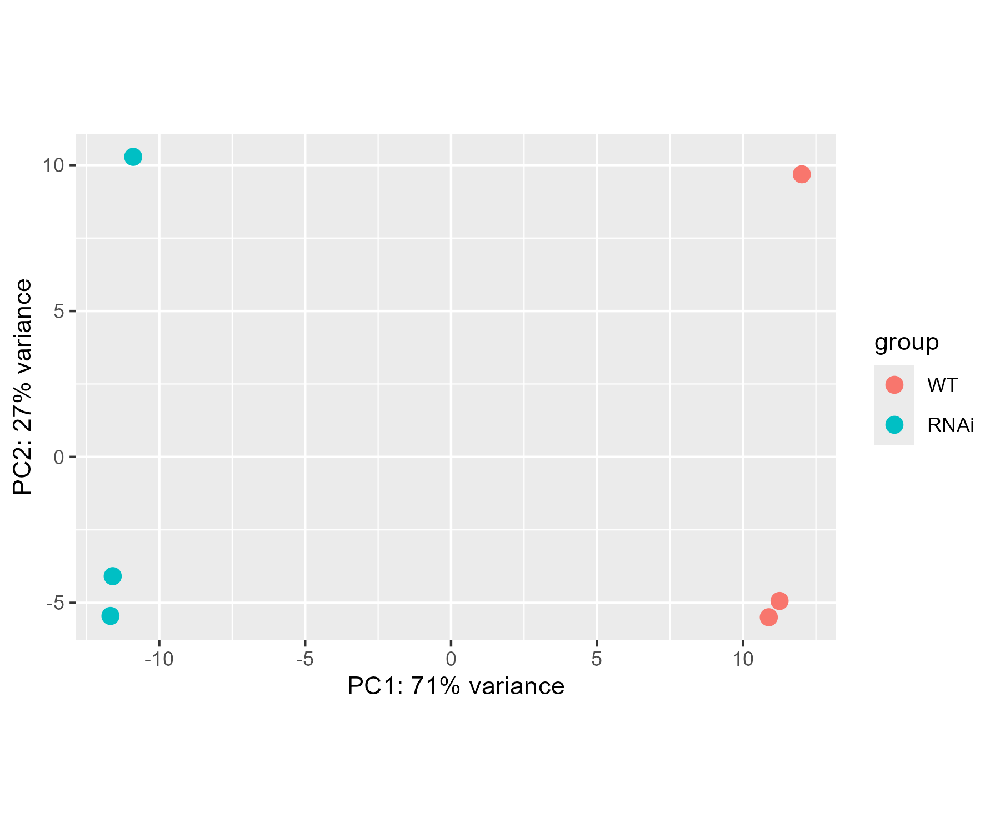
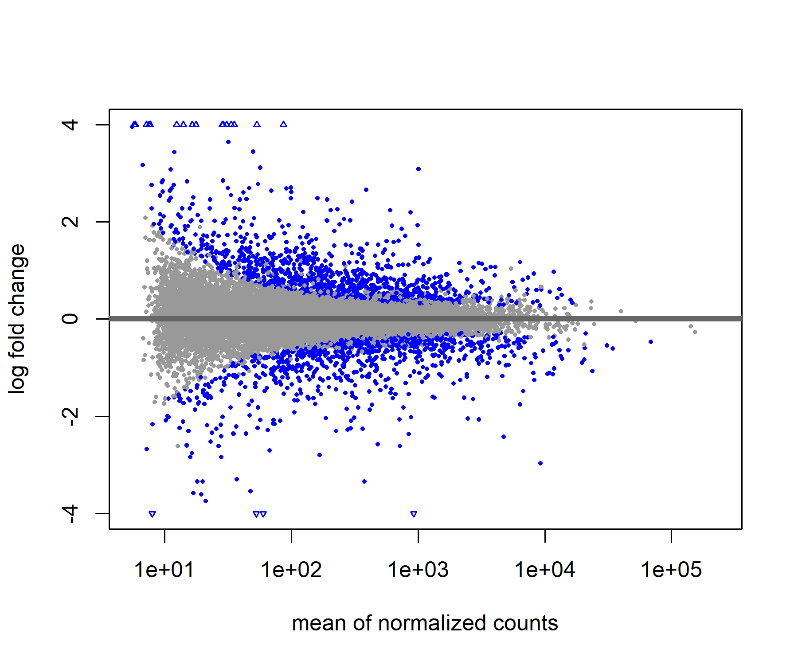
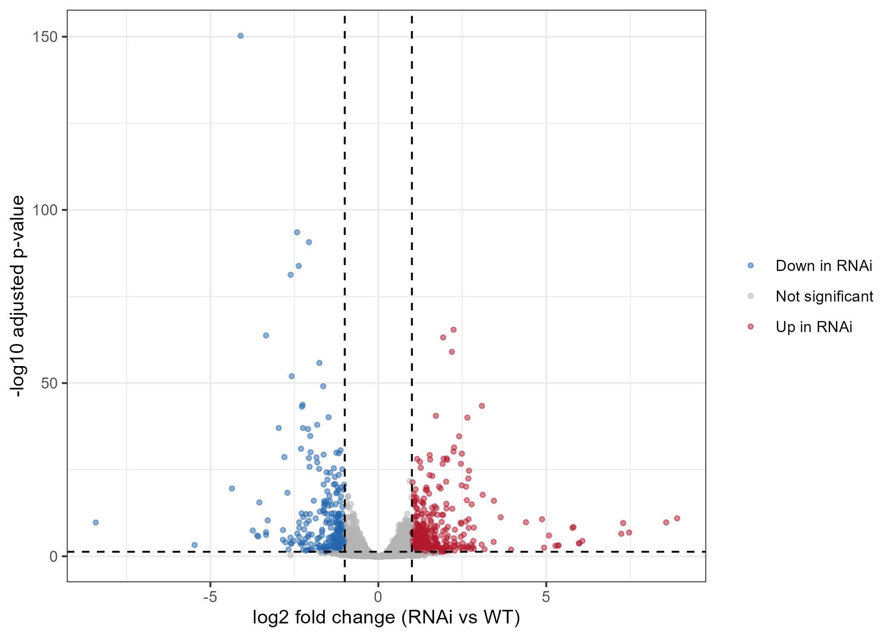
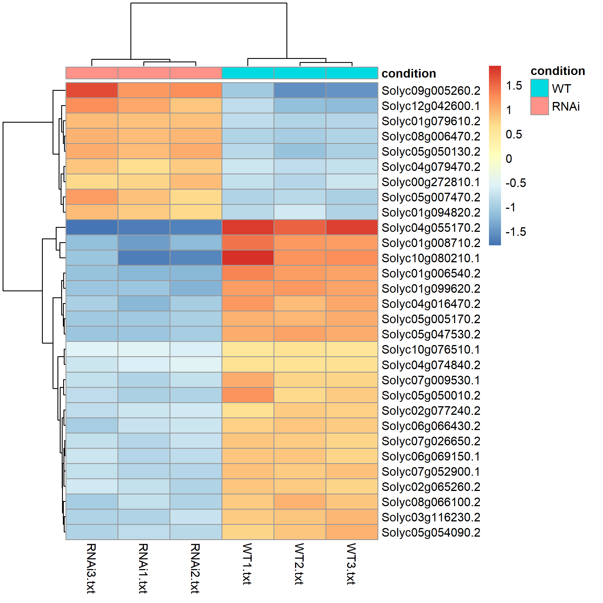

```{r setup, include=FALSE}
knitr::opts_chunk$set(echo = TRUE)
```
### Background
This project re-analyses a published RNA-seq experiment on tomato fruit ripening to determine which genes change activity when the SlDof1 gene is reduced.

### Data
The raw count matrix was generated from six tomato samples (three wild-type and three SlDof1-RNAi replicates) downloaded from NCBI GEO (GSE119493).

### Methods
Differential expression analysis was performed using the DESeq2 package in R.

### Results
The analysis identified 1,973 statistically significant differentially expressed genes. 









### Limitations
The study relies on only three replicates per group, a single time point, and a knockdown rather than a full knockout.

## Session Information
```{r session-info}
sessionInfo()